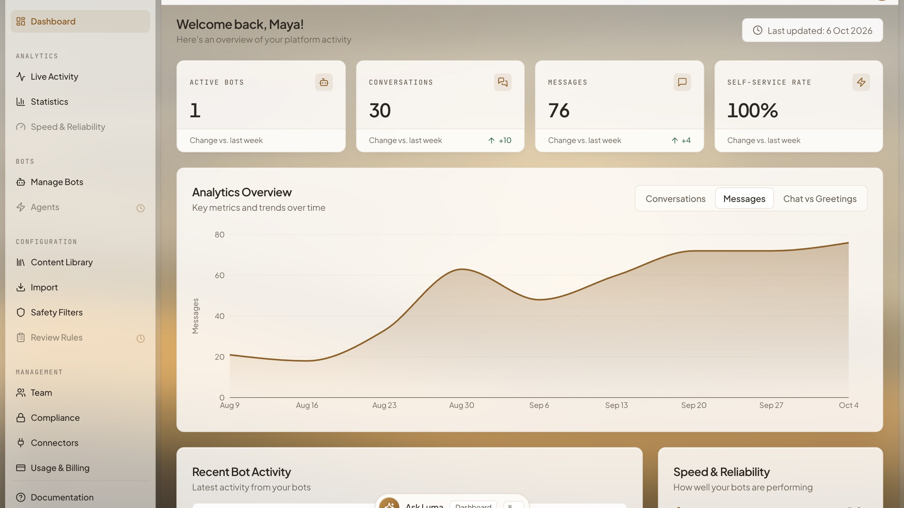

  <a href="https://www.hoverbot.ai">
    <picture>
      <source media="(prefers-color-scheme: dark)" srcset="assets/hoverbot-logo-on-dark.svg">
      
    </picture>
  </a>

<h3 align="center">Product-aware AI chat for ecommerce and marketplace teams.</h3>

  <a href="https://www.hoverbot.ai"><b>Website</b></a>
  &nbsp;&middot;&nbsp;
  <a href="https://www.hoverbot.ai/blog"><b>Blog</b></a>
  &nbsp;&middot;&nbsp;
  <a href="https://www.hoverbot.ai/trust-center"><b>Trust Center</b></a>
  &nbsp;&middot;&nbsp;
  <a href="https://www.hoverbot.ai/press"><b>Press kit</b></a>
  &nbsp;&middot;&nbsp;
  <a href="https://www.linkedin.com/company/hoverbotai/"><b>LinkedIn</b></a>
  &nbsp;&middot;&nbsp;
  <a href="https://x.com/hoverbotai"><b>X</b></a>

 

HoverBot is an AI chatbot platform for customer support and lead capture. It grounds every answer in a company's own catalog, policies, and documentation using retrieval-augmented generation, masks personal data before it reaches the model, and hands conversations to human agents when confidence drops. HoverBot was founded in 2025, is bootstrapped, and is headquartered in Singapore.

<table>
  <tr>
    <td width="50%" valign="top">
      <b>Grounded answers</b> 
      Replies come from your live product catalog, policies, and docs, so they stay accurate as the content changes.
    </td>
    <td width="50%" valign="top">
      <b>Private by default</b> 
      Personal data is masked before it reaches the model. Topic boundaries and content filters keep conversations in scope.
    </td>
  </tr>
  <tr>
    <td width="50%" valign="top">
      <b>Human handoff</b> 
      Confidence-based routing escalates to a human agent with the full conversation attached.
    </td>
    <td width="50%" valign="top">
      <b>Fits your store</b> 
      Paste one install snippet on any site, or use the WordPress plugin. A connected Shopify or WooCommerce store lets the bot answer order status.
    </td>
  </tr>
</table>

  <picture>
    <source media="(prefers-color-scheme: dark)" srcset="assets/hoverbot_dashboard_growth_dark_2026-10.jpg">
    
  </picture>
   
  Sample store workspace. Traffic history is simulated for illustration.

### Open source

| Repository | What it is |
| --- | --- |
| [hoverbot-chatbot-client](https://github.com/HoverBotAI/hoverbot-chatbot-client) | A lightweight chatbot widget client for the HoverBot platform. MIT licensed. |

### At a glance

|  |  |
| --- | --- |
| **Founded** | 2025 |
| **Headquarters** | Singapore |
| **Funding** | Bootstrapped |
| **Startup programs** | Member of the Claude for Startups, AWS Activate and Microsoft for Startups programs. |
| **Customers** | In production with customers under NDA. HoverBot names a customer only with their written consent; reference calls can be arranged on request. |
| **Category** | AI chatbot management platform |
| **Channels** | Website widget |
| **Compliance** | GDPR and PDPA controls active; SOC 2 Type II in progress ([Trust Center](https://www.hoverbot.ai/trust-center)) |

### Find us elsewhere

| Listing | What it shows |
| --- | --- |
| [WordPress.org plugin directory](https://wordpress.org/plugins/hoverbot/) | Plugin reviewed and approved by the WordPress.org plugin team, with public version history. |
| [Claude Connectors Directory](https://claude.ai/directory/hoverbot) | HoverBot's MCP connector, listed by Anthropic. |
| [e27](https://e27.co/startups/hoverbot/) | Startup profile on Southeast Asia's startup platform. |
| [Crunchbase](https://www.crunchbase.com/organization/hoverbot) | Company profile: founded January 2025, no funding rounds. |

### Contact

Questions, partnerships, or media enquiries: [support@hoverbot.ai](mailto:support@hoverbot.ai) or [hoverbot.ai/contact](https://www.hoverbot.ai/contact).
Logos, boilerplate, and screenshots are in the [press kit](https://www.hoverbot.ai/press).
